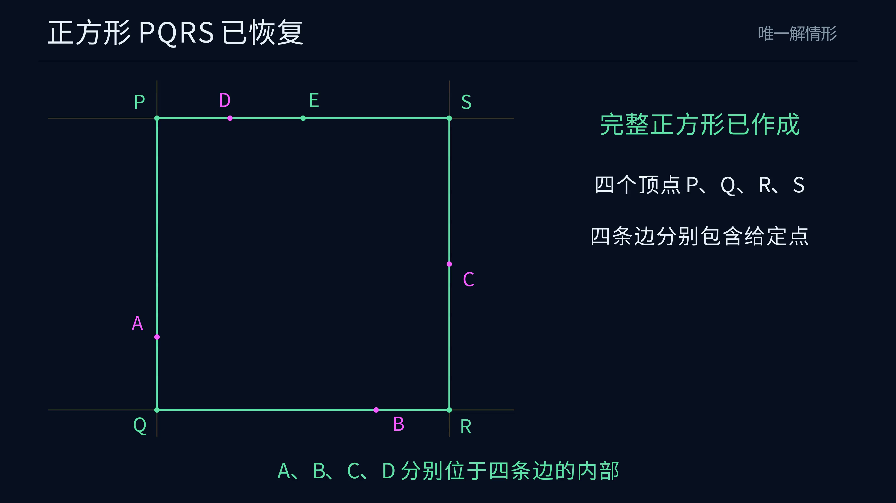

# Euclid-Square-Reconstruction

[简体中文](README.md) · **English**

**Given four points, classify squares with one given point in the strict interior of each side, and reconstruct the unique solution by the cross construction.**

This is the seventh project in the Euclid geometry research series. It provides a complete solution classification, two equivalent criteria, a finite straightedge-and-compass construction, a general correctness proof, exact SageMath replay, independent verification and a Manim construction animation. It also derives exact probabilities for four independent uniform points in the unit square and checks them by Monte Carlo simulation.

[Watch the 4K60 construction animation](https://raw.githubusercontent.com/lenovobenben/euclid-square-reconstruction/main/animations/reconstruction/media/SquareReconstruction_4k60.mp4) · [Complete construction](docs/ANSWER.md) · [Proof](docs/PROOF.md) · [Run and verify](#run-and-verify)

[](https://raw.githubusercontent.com/lenovobenben/euclid-square-reconstruction/main/animations/reconstruction/media/SquareReconstruction_4k60.mp4)

*Click the preview to watch or download the construction animation, 3840 × 2160, 60 fps, 52.35 seconds. Detailed mathematical documents and animation captions are in Chinese.*

## Watch the animation

The movie uses the exactly verified points $A=(0,1)$, $B=(3,0)$, $C=(4,2)$ and $D=(1,4)$. It follows the cross construction through the opposite-side intersection, the target side line and all four vertices, recovering the square $[0,4]^2$. A short closing explanation uses equal projection spans to show why the auxiliary point lies on the target side line.

The animation follows the series' deep-blue background, Chinese captions and fine-line style. The complete circle and both intersections appear during point selection, followed by an enlarged construction view. Perpendiculars, parallels and segment transfer use the documented classical straightedge-and-compass macros. Storyboard, geometric regression tests and rendering instructions appear in the [animation guide](animations/reconstruction/README.md).

## Problem and operations

The input consists of four points in the Euclidean plane. A valid solution is a geometric square with positive side length, with the four given points assigned bijectively to the four sides and lying in their strict interiors. Input order is arbitrary. The program relabels the points $A,B,C,D$ in counterclockwise convex-hull order. Solutions are counted by the geometric position of the square.

The construction uses an unmarked straightedge and a collapsible compass. Perpendiculars, parallels and segment transfer use classical finite macros, and exact side-of-line tests select the required intersection. The unique-solution construction returns all four vertices, four supporting lines and corresponding side segments. [Input and operation model](docs/DESIGN.md) · [Macro expansions](docs/CONSTRUCTION.md)

## Solution classification

**Every input has zero, one or infinitely many solutions.** First check whether the four points form a strictly convex quadrilateral. If they do, let $J(x,y)=(-y,x)$ and construct

$$E=B+J(C-A).$$

| Input configuration | Solutions |
|---|---|
| The four points fail to form a strictly convex quadrilateral | $0$ |
| Strictly convex, with $E=D$, equivalently equal-length perpendicular diagonals | Infinitely many |
| Strictly convex, with $E\ne D$, and, taking $DE$ as vertical, $A,C$ uniquely attain the two vertical extremes while $B,D$ uniquely attain the two horizontal extremes | $1$ |
| Strictly convex, with $E\ne D$, and the strict-extreme condition fails | $0$ |

The configuration determines which point in each pair is higher, lower, left or right. The four strict extremes guarantee that each given point lies in the interior of its assigned side segment. An equivalent coordinate criterion requires four side-position parameters to lie strictly between $0$ and $1$, supporting exact computation and cross-checks. [Both criteria and the complete proof](docs/CLASSIFICATION.md)

## Construction

For an input already classified as having a unique solution, label the points $A,B,C,D$ in counterclockwise convex-hull order.

1. Join $A,C$ and construct the perpendicular to line $AC$ through $B$.
2. Draw the circle centered at $B$ with radius $AC$. Select its intersection $E$ with the perpendicular on the opposite side of line $AC$ from $B$.
3. Join $D,E$ to obtain the target square's side line through $D$.
4. Construct perpendiculars to $DE$ through $A,C$, and a parallel to $DE$ through $B$.
5. Intersect adjacent side lines to obtain the four vertices $P,Q,R,S$ and the complete square.

The cross satisfies

$$BE=AC,\qquad BE\perp AC,\qquad \overrightarrow{BE}=J\overrightarrow{AC}.$$

Throughout the unique-solution domain, the opposite-side intersection exists and is unique, $D\ne E$, and $DE$ determines the target side direction. The auxiliary point $E$ may lie inside the target side segment, at a vertex or on its extension. All four given points satisfy the strict side-interior requirement. [Complete construction](docs/ANSWER.md) · [Correctness and finiteness](docs/PROOF.md)

## Random-point probabilities

Sample four points independently and uniformly in the unit square. The target square may have any position in the plane. The unconditional probability of a unique solution is

$$q=\frac47\ln2-\frac{16}{63}-\frac{\sqrt3\pi}{270}-\frac{41\pi}{6720}
\approx0.1027950677614.$$

| Solutions | Exact probability | Percentage |
|---|---|---|
| $0$ | $1-q$ | 89.7204932% |
| $1$ | $q$ | 10.2795068% |
| Infinitely many | $0$ | 0% |

The probability of strict convexity is $25/36$. Conditional on strict convexity, the unique-solution probability is $36q/25$, approximately **14.8024898%**. The probability documents contain the full configuration table, analytic derivation, 100-million-sample results and an account of the statistical deviations. [Probability table and Monte Carlo](docs/PROBABILITY.md) · [Analytic proof](docs/PROBABILITY_PROOF.md)

## Exact verification

The classification code implements both the geometric-extreme and coordinate criteria. An independent solver enumerates all 24 point-to-side assignments. The construction records actual points, lines, circles and intersections, using exact real-algebraic arithmetic in SageMath. Independent checks verify the resulting square and membership in all four open side segments.

| Check | Result |
|---|---|
| Symbolic classification identities | 12 passed |
| Rational-grid inputs | 1,820 passed, covering all three solution counts |
| Independent linear-system checks | 51,696 point-to-side assignments passed, with matching counts and unique-solution vertices |
| Complete cross constructions | 441 exact replays passed |
| Inputs outside the construction domain and malformed inputs | 1,809 rejected according to the interface contract |
| Animation regressions | 6 groups passed, covering dependencies, incidence, labels, unfilled shapes, equal projections and output timelines |
| Probability verification | Exact closed-form checks and recorded results from 100 million Monte Carlo samples |

Cases cover point permutations, rotations, translations, scaling and reflections, continuous-family endpoints, auxiliary points at vertices or beyond side segments, $10^{-100}$-scale near-degeneracies and irrational algebraic coordinates. The general proof covers arbitrary real coordinates. The construction implementation accepts real-algebraic coordinates. [Classification checks](docs/CLASSIFICATION.md#9-精确核验入口) · [Construction checks](docs/PROOF.md#7-精确核验)

## Run and verify

From the project root, with SageMath 10.7 installed, run the following commands.

```sh
sage -python experiments/verify_classification.py
sage -python experiments/verify_linear_system.py
sage -python experiments/verify_construction.py
```

The pinned Docker command for macOS/Linux is below. Replace the final script path to run another verifier.

```sh
docker run --rm --network none \
  -e PYTHONDONTWRITEBYTECODE=1 -e OPENBLAS_NUM_THREADS=1 \
  -v "$PWD:/workspace:ro" -w /workspace \
  sagemath/sagemath@sha256:4f5589eb6c565949a006f8665de2876b8414410daf5ac554f4434a15d4f3d528 \
  sage -python experiments/verify_classification.py
```

`construct_square(coordinates)` accepts four unordered points with real-algebraic coordinates. For a unique-solution input, it returns the vertices, side lines, circle and construction trace. Animation data are exported by replaying the formal construction and comparing the vertices with the independent solver before saving the exact example. API details, probability reproduction and animation rendering appear in the corresponding guides. [Construction API](docs/ANSWER.md#7-精确重放) · [Probability reproduction](docs/PROBABILITY.md#5-复现) · [Animation reproduction](animations/reconstruction/README.md#复现) · [Windows command](README.md#运行与核验)

## Files

| Purpose | Entry |
|---|---|
| Inputs, tools and output contract | [DESIGN](docs/DESIGN.md) |
| Both criteria, all solution counts, continuous families and examples | [CLASSIFICATION](docs/CLASSIFICATION.md) |
| Complete construction and classical macros | [ANSWER](docs/ANSWER.md), [CONSTRUCTION](docs/CONSTRUCTION.md) |
| Correctness, uniqueness and finiteness | [PROOF](docs/PROOF.md) |
| Complete probability table and Monte Carlo checks | [PROBABILITY](docs/PROBABILITY.md) |
| Closed-form proof and analytic certificate | [PROBABILITY_PROOF](docs/PROBABILITY_PROOF.md), [probability_analytic.json](experiments/results/probability_analytic.json) |
| Main construction and exact geometry | [square_reconstruction.py](experiments/square_reconstruction.py) |
| Classification, independent equations and construction checks | [verify_classification.py](experiments/verify_classification.py), [verify_linear_system.py](experiments/verify_linear_system.py), [verify_construction.py](experiments/verify_construction.py) |
| Complete construction example and exact certificate | [animation_example.json](experiments/results/animation_example.json) |
| 100-million-sample record | [probability_all_inputs_monte_carlo.json](experiments/results/probability_all_inputs_monte_carlo.json) |
| Manim animation, data and rendering | [Animation guide](animations/reconstruction/README.md) |

## Sources and scope

The problem and cross construction originate in the author's “尺规作图—十字架” exchange in `ai-math-notes`. This project gives a complete classification combining strict side-interior conditions, zero- and unique-solution criteria and continuous solution families. It develops the finite straightedge-and-compass construction for every unique-solution input, a general proof and independent exact verification. Analytic random-input probabilities and Monte Carlo records appear in the probability documents. [Original exchange](https://github.com/lenovobenben/ai-math-notes/blob/main/chatgpt/经典数学题100例-4/001_尺规作图-十字架__691d671c-4bd4-832a-8020-6d1040b2fd4a/001_尺规作图-十字架__691d671c-4bd4-832a-8020-6d1040b2fd4a.md)

**Euclid geometry research series**

[Euclid-Min](https://github.com/lenovobenben/euclid-min) · [Euclid-CCC-Min](https://github.com/lenovobenben/euclid-ccc-min) · [Euclid-Equal-Angle-Min](https://github.com/lenovobenben/euclid-equal-angle-min) · [Euclid-Castillon-Min](https://github.com/lenovobenben/euclid-castillon-min) · [Euclid-Conic-Classification](https://github.com/lenovobenben/euclid-conic-classification) · [Euclid-Cubic-Trisection](https://github.com/lenovobenben/euclid-cubic-trisection) · **Euclid-Square-Reconstruction**
