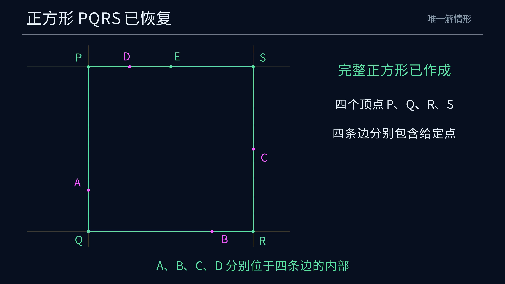

# Euclid-Square-Reconstruction · 四个边内点恢复正方形

**简体中文** · [English](README.en.md)

**给定四点，要求它们分别位于正方形四条边的严格内部，判定全部解数，并用十字架法恢复唯一解。**

本项目是 Euclid 几何研究系列的第七题，提供完整解集分类、两种等价判据、有限尺规构造、一般正确性证明、SageMath 精确重放与独立核验，以及 Manim 作图动画。另给出单位正方形均匀取点模型下的解析概率与蒙特卡洛验证。

[观看 4K60 作图动画](https://raw.githubusercontent.com/lenovobenben/euclid-square-reconstruction/main/animations/reconstruction/media/SquareReconstruction_4k60.mp4) · [完整作图答案](docs/ANSWER.md) · [正确性证明](docs/PROOF.md) · [运行与核验](#运行与核验)

[](https://raw.githubusercontent.com/lenovobenben/euclid-square-reconstruction/main/animations/reconstruction/media/SquareReconstruction_4k60.mp4)

*点击预览图观看或下载作图动画，3840 × 2160、60 fps、52.35 秒。*

## 先看动画

动画采用已精确核验的四点 $A=(0,1)$、$B=(3,0)$、$C=(4,2)$、$D=(1,4)$，连续展示十字架辅助点、异侧选点、目标边线及四个顶点的取得，最终恢复正方形 $[0,4]^2$。末段用相等的投影跨度解释辅助点为什么位于目标边线上。

沿用系列的深蓝背景、中文字幕和细线风格。选点阶段显示完整圆及两个交点，随后放大作图区域。垂线、平行线和长度转移采用文档中的经典尺规宏。详细分镜、几何回归和渲染命令见 [动画说明](animations/reconstruction/README.md)。

## 题目与工具

给定欧氏平面中的四个点，每个合法解是一个正边长的几何正方形，四个给定点与四条边一一对应，分别位于对应边段的严格内部。输入可以任意排序，程序按凸包逆时针次序重新记为 $A,B,C,D$。解按正方形的几何位置计数。

使用无刻度直尺和塌圆规。垂线、平行线及长度转移采用经典有限尺规宏，通过精确侧别关系完成交点选择。唯一解构造输出四个顶点、四条边线及对应边段。[输入与操作模型](docs/DESIGN.md) · [宏展开](docs/CONSTRUCTION.md)

## 解数分类

**解数只能为零个、一个或无穷多个。** 首先检查四点是否组成严格凸四边形。通过后，令 $J(x,y)=(-y,x)$，构造辅助点

$$E=B+J(C-A).$$

| 输入位置 | 解数 |
|---|---|
| 四点不能组成严格凸四边形 | $0$ |
| 严格凸，且 $E=D$，等价于两条对角线等长且垂直 | 无穷多 |
| 严格凸，$E\ne D$，以 $DE$ 为竖直方向时，$A,C$ 分别独占上下极值，$B,D$ 分别独占左右极值 | $1$ |
| 严格凸，$E\ne D$，上述严格极值条件失败 | $0$ |

每对点中谁高谁低、谁左谁右均由实际位置决定。四个严格极值保证四个给定点分别处于对应边段的内部。坐标判据用四个位置参数严格介于 $0,1$ 之间表达同一条件，便于精确计算及交叉核对。[两种判据与完整证明](docs/CLASSIFICATION.md)

## 构造主线

对已经判定有唯一解的输入，按凸包逆时针次序取 $A,B,C,D$。

1. 连接 $A,C$，过 $B$ 作直线 $AC$ 的垂线。
2. 以 $B$ 为圆心、$AC$ 为半径作圆，取垂线上与 $B$ 位于直线 $AC$ 异侧的交点 $E$。
3. 连接 $D,E$，得到目标正方形经过 $D$ 的边线。
4. 过 $A,C$ 分别作 $DE$ 的垂线，过 $B$ 作 $DE$ 的平行线。
5. 取四条边线的相邻交点，得到四个顶点 $P,Q,R,S$ 及完整正方形。

十字架关系满足

$$BE=AC,\qquad BE\perp AC,\qquad \overrightarrow{BE}=J\overrightarrow{AC}.$$

在全部唯一解输入上，异侧交点存在且唯一，$D\ne E$，直线 $DE$ 确定目标边方向。辅助点 $E$ 可以位于目标边段内部、顶点或延长部分，给定四点均保持严格边内部约束。[完整作法](docs/ANSWER.md) · [正确性与有限性证明](docs/PROOF.md)

## 随机取点的概率

在单位正方形内独立均匀取四点，目标正方形可位于平面任意位置。唯一解的无条件概率为

$$q=\frac47\ln2-\frac{16}{63}-\frac{\sqrt3\pi}{270}-\frac{41\pi}{6720}
\approx0.1027950677614.$$

| 解数 | 解析概率 | 百分比 |
|---|---|---|
| $0$ | $1-q$ | 89.7204932% |
| $1$ | $q$ | 10.2795068% |
| 无穷多 | $0$ | 0% |

四点严格凸的概率为 $25/36$。以严格凸为条件，唯一解概率为 $36q/25$，约 **14.8024898%**。完整分类概率表、解析推导、一亿组抽样结果及统计偏差说明保存在概率文档中。[概率表与蒙特卡洛](docs/PROBABILITY.md) · [解析证明](docs/PROBABILITY_PROOF.md)

## 代码与精确结果

分类程序同时实现几何极值判据和坐标判据，独立求解器枚举全部 24 种点边对应关系。构造程序按点、线、圆及交点记录实际动作，在 SageMath 精确实代数数域中求交与选点，独立核对最终正方形和四条开边段成员关系。

| 核验内容 | 结果 |
|---|---|
| 分类的符号恒等式 | 12 项通过 |
| 有理网格输入 | 1,820 组通过，包含三种解数 |
| 独立线性方程复核 | 51,696 种点边对应通过，解数及唯一解顶点一致 |
| 完整十字架作图 | 441 次精确重放通过 |
| 构造域之外及格式错误的输入 | 1,809 次按接口约定拒绝 |
| 动画动作与显示几何回归 | 6 组通过，覆盖对象依赖、点线关联、标签、无填充样式、等长投影及输出时间线 |
| 概率核验 | 闭式精确核验，并记录一亿组蒙特卡洛结果 |

案例覆盖点名排列、旋转、平移、缩放与反射、连续解族端点、辅助点位于顶点或边段外、$10^{-100}$ 级邻近退化及无理代数坐标。一般证明覆盖任意实坐标，作图程序支持实代数坐标。[分类核验](docs/CLASSIFICATION.md#9-精确核验入口) · [构造核验](docs/PROOF.md#7-精确核验)

## 运行与核验

在项目根目录使用 SageMath 10.7 运行。

```sh
sage -python experiments/verify_classification.py
sage -python experiments/verify_linear_system.py
sage -python experiments/verify_construction.py
```

Windows PowerShell 可使用与上一题相同的固定 Docker 镜像。替换命令末尾的脚本路径即可运行其他核验入口。

```powershell
docker run --rm --network none -e PYTHONDONTWRITEBYTECODE=1 -e OPENBLAS_NUM_THREADS=1 -v "${PWD}:/workspace:ro" -w /workspace sagemath/sagemath@sha256:4f5589eb6c565949a006f8665de2876b8414410daf5ac554f4434a15d4f3d528 sage -python experiments/verify_classification.py
```

`construct_square(coordinates)` 接收四个无序实代数坐标点，在唯一解输入上返回全部顶点、边线、圆及作图动作。动画数据由正式构造重放导出，并与独立求解器比较顶点后保存精确案例。接口说明、概率重算及动画渲染分别见对应文档。[构造接口](docs/ANSWER.md#7-精确重放) · [概率复现](docs/PROBABILITY.md#5-复现) · [动画复现](animations/reconstruction/README.md#复现)

## 成果入口

| 内容 | 文件 |
|---|---|
| 题面、工具、输入和输出 | [DESIGN](docs/DESIGN.md) |
| 两种判据、全部解数、连续解族与案例 | [CLASSIFICATION](docs/CLASSIFICATION.md) |
| 完整尺规构造与经典宏 | [ANSWER](docs/ANSWER.md)、[CONSTRUCTION](docs/CONSTRUCTION.md) |
| 正确性、唯一性与有限性证明 | [PROOF](docs/PROOF.md) |
| 完整概率表与蒙特卡洛核对 | [PROBABILITY](docs/PROBABILITY.md) |
| 概率闭式证明与解析证书 | [PROBABILITY_PROOF](docs/PROBABILITY_PROOF.md)、[probability_analytic.json](experiments/results/probability_analytic.json) |
| 主构造与精确几何 | [square_reconstruction.py](experiments/square_reconstruction.py) |
| 分类、独立方程与构造核验 | [verify_classification.py](experiments/verify_classification.py)、[verify_linear_system.py](experiments/verify_linear_system.py)、[verify_construction.py](experiments/verify_construction.py) |
| 完整作图案例与精确证书 | [animation_example.json](experiments/results/animation_example.json) |
| 一亿组抽样记录 | [probability_all_inputs_monte_carlo.json](experiments/results/probability_all_inputs_monte_carlo.json) |
| Manim 动画、数据与渲染 | [动画目录](animations/reconstruction/README.md) |

## 来源与项目定位

题目及十字架作法来自作者在 `ai-math-notes` 中的“尺规作图—十字架”问答。本项目将严格边内部条件、零解与唯一解判据、连续解族统一为完整分类，并展开唯一解的有限尺规构造、一般证明及独立精确核验。随机输入的解析概率与蒙特卡洛记录另行保存于概率文档。[原始问答](https://github.com/lenovobenben/ai-math-notes/blob/main/chatgpt/经典数学题100例-4/001_尺规作图-十字架__691d671c-4bd4-832a-8020-6d1040b2fd4a/001_尺规作图-十字架__691d671c-4bd4-832a-8020-6d1040b2fd4a.md)

**Euclid 几何研究系列**

[Euclid-Min](https://github.com/lenovobenben/euclid-min) · [Euclid-CCC-Min](https://github.com/lenovobenben/euclid-ccc-min) · [Euclid-Equal-Angle-Min](https://github.com/lenovobenben/euclid-equal-angle-min) · [Euclid-Castillon-Min](https://github.com/lenovobenben/euclid-castillon-min) · [Euclid-Conic-Classification](https://github.com/lenovobenben/euclid-conic-classification) · [Euclid-Cubic-Trisection](https://github.com/lenovobenben/euclid-cubic-trisection) · **Euclid-Square-Reconstruction**
