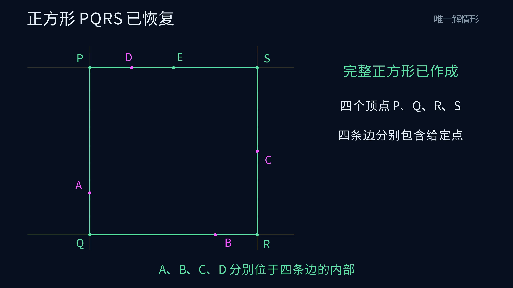

# 唯一解情形的十字架作图动画

[观看 4K60 MP4](media/SquareReconstruction_4k60.mp4)

成片时长 52.35 秒，分辨率 3840 × 2160，帧率 60 fps。



## 展示内容

采用 [ANSWER](../../docs/ANSWER.md) 中已精确核验的案例

$$A=(0,1),\quad B=(3,0),\quad C=(4,2),\quad D=(1,4).$$

依次连接 $AC$、过 $B$ 作垂线、以 $B$ 为圆心复制 $AC$ 的长度、选择异侧交点 $E$、连接 $DE$、恢复其余三条边与四个顶点。选点阶段显示完整圆及两个交点，随后放大作图区域。末段用两个相等的投影跨度说明 $E,D$ 为什么共处目标边线。

沿用系列的深蓝背景、中文字幕和细线样式。洋红表示给定点，金色表示当前动作，淡蓝表示辅助对象，绿色表示所选交点和结果。垂线、平行线与长度转移使用 [经典尺规宏](../../docs/CONSTRUCTION.md)，主圆和实际选点均完整显示。

## 数据与检查

[export_animation.py](../../experiments/export_animation.py) 重放正式构造，检查四条开边段成员关系，再与独立线性方程求解器比较顶点。通过后保存 [精确案例](../../experiments/results/animation_example.json)，并导出 [显示数据](geometry.json) 与其 SHA-256。

Manim 加载时核对数据、精确案例与来源源码摘要。六组回归检查覆盖动作及父对象顺序、主图与全圆视图的点线关联、标签位置、无填充样式、证明中的等长投影，以及各输出视频独立的时间线。

## 复现

所有命令在项目根目录执行。SageMath 环境见 [运行与核验](../../README.md#运行与核验)。

```sh
sage -python experiments/verify_construction.py
sage -python experiments/export_animation.py
```

沿用含 Manim Community 0.21.0 与 Noto Sans CJK SC 的镜像。重建命令为

```powershell
docker build -t euclid-min-manim:0.21.0 animations/reconstruction
```

运行检查与 4K60 渲染

```powershell
docker run --rm --network none -e PYTHONDONTWRITEBYTECODE=1 -v "${PWD}:/manim" -w /manim euclid-min-manim:0.21.0 python -m unittest discover -s animations/reconstruction -p 'test_*.py' -v
docker run --rm --network none -e PYTHONDONTWRITEBYTECODE=1 -v "${PWD}:/manim" -w /manim euclid-min-manim:0.21.0 manim --config_file animations/reconstruction/manim.cfg -o SquareReconstruction_4k60.mp4 animations/reconstruction/reconstruction.py SquareReconstruction
```

预览时在渲染命令中增加 `-r 1280,720 --fps 30`，并将输出名改为 `SquareReconstruction_720p30.mp4`。

正式渲染输出位于 `media/videos/reconstruction/2160p60/`。播放副本采用索引前置，时间线同时复制到播放文件旁。

```powershell
ffmpeg -y -i animations/reconstruction/media/videos/reconstruction/2160p60/SquareReconstruction_4k60.mp4 -c copy -movflags +faststart animations/reconstruction/media/SquareReconstruction_4k60.mp4
Copy-Item -LiteralPath animations/reconstruction/media/videos/reconstruction/2160p60/SquareReconstruction_4k60.timeline.json -Destination animations/reconstruction/media/SquareReconstruction_4k60.timeline.json
```
